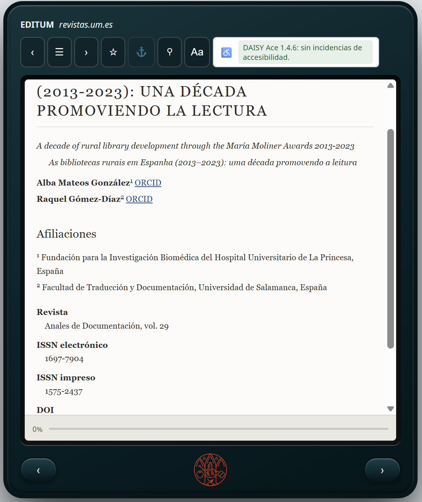

[](https://doi.org/10.5281/zenodo.18958457)

# Docx to JATS Assistant Plugin for OJS

[English](#english) | [Español](#español)

---

<a name="english"></a>
## English

This repository contains an **Open Journal Systems (OJS) plugin** that serves as a **guided assistant for converting DOCX documents to XML-JATS**.  

The plugin provides a **4-step workflow** designed to guide editors and technical staff throughout the tagging and validation process, significantly reducing the manual effort required to generate high-quality XML-JATS from Word documents.

The primary objective is to facilitate the adoption of the XML-JATS standard in real editorial workflows, maintaining a balance between **automated tagging** and **assisted review**.

**Supported version:** 3.3.x

### Installation

Plugin installation is performed **the same way as any other OJS plugin**:

1. Download the archive (`.tar.gz` or `.zip`) from the repository's **Releases** section:
   - https://github.com/editum/JATSWizard/releases

2. Extract the file into the OJS plugins directory: `plugins/generic/`

3. Log in to the OJS administration panel and enable the plugin under: **Settings → Website → Plugins → Generic Plugins**

New versions of the plugin will be published exclusively through the **Releases** section, which should be considered the official distribution channel.

### External Dependency: Docx → JATS Conversion Pipeline

⚠️ **This plugin does not perform the conversion directly.**

The OJS assistant relies on an **external conversion pipeline**, responsible for transforming the DOCX document into XML-JATS and applying the auto-tagging rules.

This pipeline is located in the following repository and **must be deployed and accessible via a web URL**:

👉 https://github.com/editum/docxtojats-pipeline

During the plugin configuration in OJS, you will be explicitly prompted for:

- **The URL of the `docxtojats-pipeline` API**
- The URL is required and must use **HTTPS**; there is no default endpoint.

cURL validates the HTTPS certificate and hostname using the server's trusted CA
store. For an internal pipeline CA, configure PHP/cURL with that CA (for example
through `curl.cainfo`) instead of disabling TLS verification.

cURL validates the HTTPS certificate and hostname using the server's trusted CA
store. For an internal pipeline CA, configure PHP/cURL with that CA (for example
through `curl.cainfo`) instead of disabling TLS verification.

Before starting a conversion, copy the article's bibliographic references into the publication's **Citations** metadata field in OJS and save the publication. The wizard blocks conversion when this field is empty.

An experimental bibliography-segmentation pilot is available in the wizard start screen. It is off by default. When explicitly selected, the wizard shows the proposed reference boundaries and waits for confirmation before generating CSL/JATS; the original citations remain available as an alternative. Review the result carefully and use a test submission or copy, not a published submission.

For example:

```text
https://pipeline.my-domain.com/api/
```

### EPUB generation and validation

When the HTML export builds an EPUB 3 galley, JATS Wizard runs EPUBCheck and
DAISY Ace on the generated file before storing it in OJS. Their results are
saved with the galley. Editors can run the same checks again on an existing
EPUB galley with **Revalidate ePub**. A failed or unavailable check does not
block galley creation; the result is reported rather than silently corrected.

Install the tools on the OJS server and set `JV_TOOLS` in the PHP/web-server
environment to their common parent directory. It must contain:

```text
$JV_TOOLS/epubcheck/epubcheck.jar
$JV_TOOLS/epubcheck/lib/*.jar
$JV_TOOLS/ace/node_modules/@daisy/ace/bin/ace.js
```

The PHP process must be able to run Java and Node.js. The defaults are
`C:/laragon/tools` on Windows and `/opt/jv-tools` on Unix-like systems; setting
`JV_TOOLS` explicitly is recommended. If either tool is missing, OJS records
that it could not run. The JATS/EPUB workflow also requires the PHP `dom`,
`xsl`, `zip`, `curl` and `mbstring` extensions.

The automated checks do not certify WCAG conformance or replace an independent
accessibility audit. Semantic decisions such as writing meaningful image
descriptions remain editorial work. The separate EPUB assembled in the browser
by the online reader is not passed through these server-side checks.

### PDF FlipBook

The optional FlipBook galley is created from a PDF in the production workflow.
It requires the OJS **PDF.js Viewer** generic plugin to be enabled; JATS Wizard
uses it to render the PDF pages. It adds a page-turn reader with navigation,
search, fullscreen and an opt-in page-turn sound. Re-upload/recreate the galley
after plugin updates if an existing static galley still references older assets.
Creating FlipBook galleys and revalidating EPUB galleys require an editor,
assistant editor or journal manager role in OJS.

### HTML article viewer

The HTML galley embeds the viewer CSS and JavaScript when it is generated. After changing `assets/viewer/viewer.css` or the HTML exporter, regenerate and replace the HTML galley for those changes to appear. Table content supplied in JATS as a graphic remains an image; native, responsive tables require actual table markup in the source JATS.

### ePub reader

The embedded ePub.js reader uses one fixed, portrait virtual-tablet design branded for EDITUM and revistas.um.es. Readers cannot select or switch between device models. The shell frames the article reading area and includes the reader toolbar, progress indicator and physical-style previous/next controls. This is a custom interface treatment, not a physical device or an official manufacturer interface.

The image below is an actual screenshot of the fixed reader in portrait format. It shows the full tablet frame at its native aspect ratio.



The reading area adapts to the available viewport and avoids constraining article text to its original print-like margins. Bookerly and Literata are font fallbacks only; the plugin does not distribute proprietary fonts.

In paginated mode, the reader removes inner page padding so figures and tables stay within the column width; scrolling mode keeps a small reading margin.

The reader includes a chapter index, whole-book search, reading progress, a saved position, text highlights, notes, selection lookups and an optional 3D page-transition overlay. The transition animates the viewport; it does not physically fold or deform the ePub text. Stylus mode simulates selecting and highlighting text and does not provide freehand handwriting.

Reading position, preferences, bookmarks, highlights and notes are stored in the current browser's local storage; they are not synchronized to an OJS account or another device. Search scans the ePub locally when submitted and does not rewrite chapter HTML.

---

<a name="español"></a>
## Español

Este repositorio contiene un **plugin para Open Journal Systems (OJS)** que actúa como **asistente guiado de conversión de documentos DOCX a XML-JATS**.  

El plugin ofrece un flujo de trabajo en **4 pasos**, pensado para acompañar a editores y personal técnico durante el proceso de marcado y validación, reduciendo significativamente el esfuerzo manual necesario para generar XML-JATS de calidad a partir de documentos Word.

El objetivo principal es facilitar la adopción del estándar XML-JATS en flujos editoriales reales, manteniendo un equilibrio entre **automarcado automático** y **revisión asistida**.

**Versión soportada:** 3.3.x

### Instalación

La instalación del plugin se realiza **igual que cualquier otro plugin de OJS**.

1. Descarga el paquete comprimido (`.tar.gz` o `.zip`) desde la sección **Releases** del repositorio:
   - https://github.com/editum/JATSWizard/releases

2. Descomprime el fichero en el directorio de plugins de OJS: `plugins/generic/`

3. Accede al panel de administración de OJS y habilita el plugin desde: **Ajustes → Sitio web → Plugins → Plugins genéricos**

Las nuevas versiones del plugin se publicarán exclusivamente a través de la sección **Releases**, que debe considerarse el canal oficial de distribución.

### Dependencia externa: pipeline de conversión Docx → JATS

⚠️ **Este plugin no realiza la conversión directamente.**

El asistente de OJS se apoya en un **pipeline de conversión externo**, responsable de transformar el documento DOCX en XML-JATS y de aplicar las reglas de automarcado.

Este pipeline se encuentra en el siguiente repositorio y **debe estar desplegado y accesible vía web**:

👉 https://github.com/editum/docxtojats-pipeline

Durante la configuración del plugin en OJS se solicitará explícitamente:

- **La URL de la API del `docxtojats-pipeline`**
- La URL es obligatoria y debe usar **HTTPS**; no hay una dirección predeterminada.

cURL valida el certificado HTTPS y el nombre del servidor mediante las CA
confiables del sistema. Si el pipeline usa una CA interna, configúrala en
PHP/cURL (por ejemplo, con `curl.cainfo`) en vez de desactivar la validación TLS.

cURL valida el certificado HTTPS y el nombre del servidor mediante las CA
confiables del sistema. Si el pipeline usa una CA interna, configúrala en
PHP/cURL (por ejemplo, con `curl.cainfo`) en vez de desactivar la validación TLS.

Antes de iniciar una conversión, copie las referencias bibliográficas del artículo en el campo **Citas** de los metadatos de la publicación en OJS y guarde la publicación. El asistente bloquea la conversión si este campo está vacío.

El inicio del asistente ofrece un piloto experimental de segmentación bibliográfica, desactivado por defecto. Si se activa expresamente, muestra los límites propuestos y espera confirmación antes de generar CSL/JATS; también permite continuar con las citas originales. Revise el resultado y utilice un envío de prueba o una copia, no un envío publicado.

Por ejemplo:

```text
https://pipeline.mi-dominio.com/api/
```

### Generación y validación de EPUB

Cuando la exportación HTML genera una galerada EPUB 3, JATS Wizard ejecuta
EPUBCheck y DAISY Ace antes de guardar el archivo en OJS. Los resultados se
guardan asociados a la galerada. El equipo editorial puede volver a ejecutar
ambas comprobaciones sobre una galerada existente con **Revalidar ePub**. Un
fallo o la ausencia de una herramienta no bloquean la creación: se informa del
resultado y no se corrige contenido editorial de forma silenciosa.

Instala las herramientas en el servidor OJS y define `JV_TOOLS` en el entorno
de PHP/servidor web apuntando al directorio común que contenga:

```text
$JV_TOOLS/epubcheck/epubcheck.jar
$JV_TOOLS/epubcheck/lib/*.jar
$JV_TOOLS/ace/node_modules/@daisy/ace/bin/ace.js
```

El proceso PHP debe poder ejecutar Java y Node.js. Las rutas por defecto son
`C:/laragon/tools` en Windows y `/opt/jv-tools` en sistemas Unix; se recomienda
configurar `JV_TOOLS` explícitamente. Si falta alguna herramienta, OJS registra
que no pudo ejecutarla. El flujo JATS/EPUB requiere también las extensiones PHP
`dom`, `xsl`, `zip`, `curl` y `mbstring`.

Estas comprobaciones automáticas no certifican conformidad WCAG ni sustituyen
una auditoría independiente. Decisiones semánticas como redactar descripciones
útiles para las imágenes siguen correspondiendo al equipo editorial. El EPUB
que el lector en línea ensambla en el navegador sigue una ruta aparte y no pasa
por estas comprobaciones del servidor.

### FlipBook para PDF

La galerada FlipBook opcional se crea desde un PDF en el flujo de producción.
Requiere que esté habilitado el plugin genérico **PDF.js Viewer** de OJS; JATS
Wizard lo usa para renderizar las páginas. Añade navegación, búsqueda, pantalla
completa y sonido de paso de página opcional. Si una galerada estática conserva
assets antiguos tras actualizar el plugin, vuelve a crearla.
Crear galeradas FlipBook y revalidar ePub requiere un rol de editor/a,
editor/a asistente o gestor/a de la revista.

### Visor HTML del artículo

La galerada HTML incorpora el CSS y JavaScript del visor al generarse. Después de cambiar `assets/viewer/viewer.css` o el exportador HTML, hay que regenerar y sustituir la galerada para que esos cambios aparezcan. Si el JATS aporta una tabla como gráfico, se conserva como imagen; para obtener una tabla nativa y adaptable, el JATS de origen debe contener el marcado de tabla.

### Lector de ePub

El lector integrado con ePub.js utiliza un único diseño fijo de tablet virtual en formato vertical, con identidad visual de EDITUM y revistas.um.es. No se pueden seleccionar ni cambiar modelos de dispositivo. La carcasa enmarca el área de lectura e incluye la barra de herramientas, el indicador de progreso y controles físicos simulados para avanzar y retroceder. Es una propuesta visual personalizada, no un dispositivo físico ni una interfaz oficial de un fabricante.

La imagen siguiente es una captura real del lector fijo en formato vertical. Muestra la carcasa completa y conserva la proporción original de la tablet.


El área de lectura se adapta al espacio disponible y aprovecha mejor la pantalla, sin quedar limitada por los márgenes de impresión originales del artículo. Bookerly y Literata son fuentes alternativas del sistema; el plugin no distribuye tipografías propietarias.

En el modo paginado se elimina el relleno interior de cada página para que las figuras y tablas respeten el ancho de la columna; el modo de desplazamiento conserva un pequeño margen de lectura.

Incluye índice de capítulos, búsqueda en todo el libro, progreso, marcador de posición, subrayados, notas, consultas de texto seleccionado y una transición de página 3D opcional. La transición anima el visor, pero no dobla ni deforma físicamente el texto del ePub. El modo lápiz simula la selección y el subrayado; no permite escritura libre a mano.

La posición, las preferencias, los marcadores, los subrayados y las notas se guardan en el almacenamiento local del navegador actual; no se sincronizan con la cuenta OJS ni con otros dispositivos. La búsqueda recorre el ePub localmente al enviarla y no modifica el HTML de los capítulos.

---

## Sponsors

<p style="background:white">     </p>
